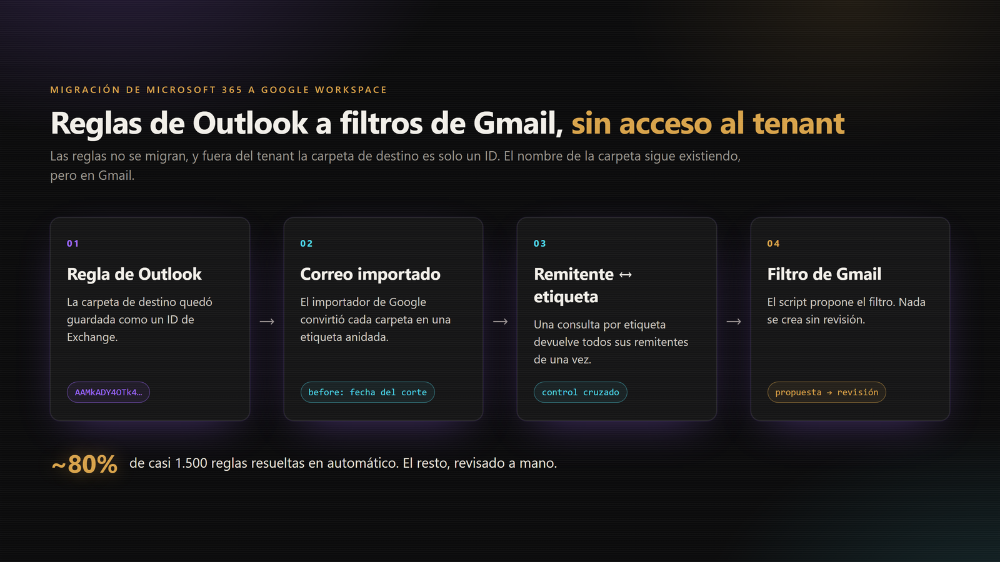
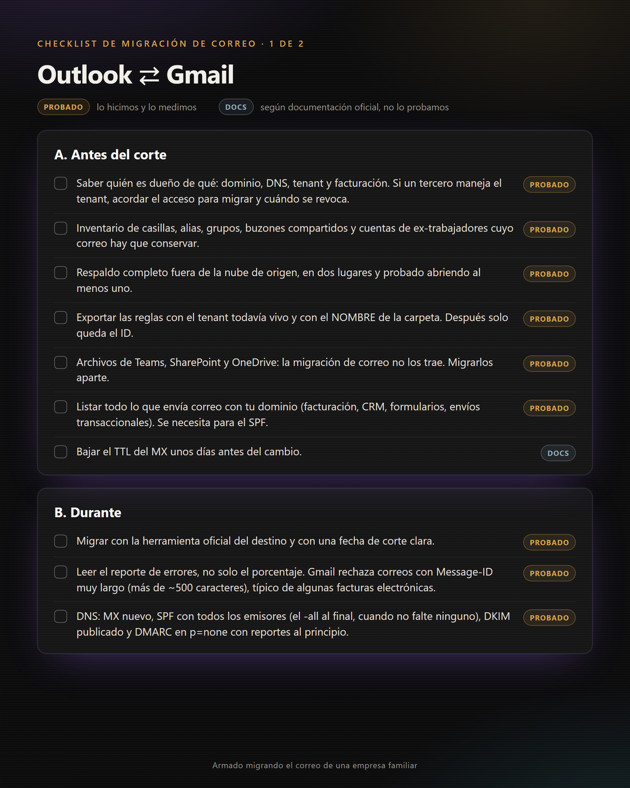
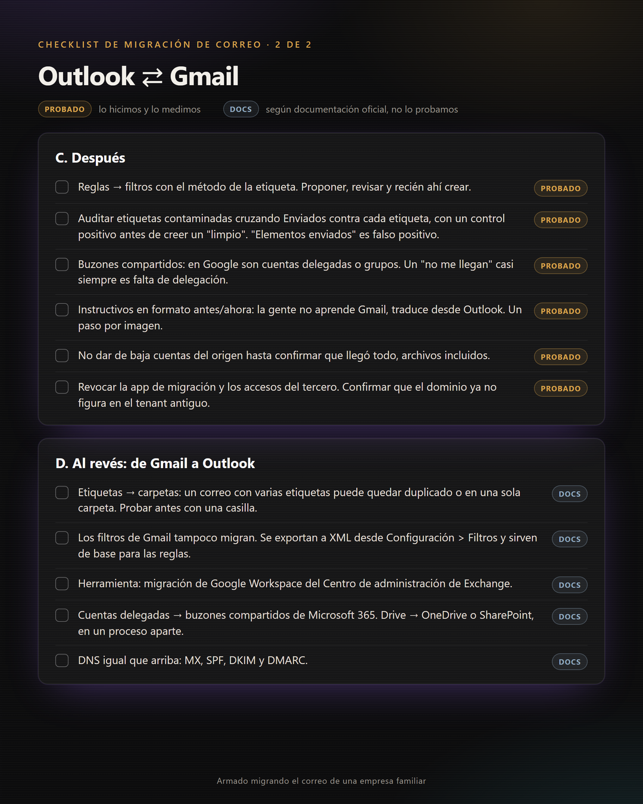

# Migración de correo Outlook ⇄ Gmail: checklist y método

Checklist y método que armamos migrando el correo de una pyme familiar de Microsoft 365 a Google Workspace, saliendo de un tenant que administraba un proveedor de TI externo. Lo dejo público porque cuando lo necesitamos no encontramos nada parecido en español.

Cada punto del checklist está marcado:

- **[Probado]**: lo hicimos y lo medimos.
- **[Docs]**: viene de la documentación oficial; no lo probamos nosotros.

## Contexto

El correo de la empresa vivía en un tenant de Microsoft compartido con otros clientes del proveedor. Crear una casilla, un alias o una regla pasaba por él. Nos fuimos a Google Workspace para que el dominio, las cuentas y los datos fueran nuestros.

Eran unas diez casillas y casi 1.500 reglas de Outlook.

## El problema que no sale en los tutoriales

Google migra el correo, los contactos y el calendario. **Las reglas de Outlook no se migran.**

Y si ya saliste del tenant, cada regla guarda la carpeta de destino como un ID opaco de Exchange (del tipo `AAMkADY4...`), no como un nombre. Sin acceso al tenant no hay cómo traducir ese ID.

## El método: el nombre de la carpeta sigue existiendo, pero en Gmail

El importador de Google convierte cada carpeta de Outlook en una **etiqueta anidada** de Gmail (por ejemplo `Bandeja de entrada/CLIENTES/CLIENTE-A`). Entonces, para saber a qué carpeta movía una regla los correos de un remitente, basta con mirar en qué etiqueta quedaron los correos de ese remitente.

1. **Consulta solo el correo anterior al corte.** Lo que llegó a Gmail después del cambio de MX entra directo a Recibidos y no trae etiqueta. En la búsqueda: `before:AAAA/MM/DD` con la fecha del corte.
2. **Consulta por etiqueta, no por remitente.** Una consulta por etiqueta devuelve todos sus remitentes de una vez: decenas de consultas en lugar de cientos.
3. **Arma el índice remitente → etiqueta** y crúzalo con las reglas exportadas (remitente → ID de carpeta).
4. **Control cruzado.** Si dos reglas apuntaban a la misma carpeta en Outlook, tienen que resolver a la misma etiqueta. Si no coinciden, el método está fallando para esa carpeta y hay que revisarla a mano.
5. **Proponer, revisar y recién ahí crear.** El proceso genera una propuesta de filtros por persona. Nada se crea sin que alguien la revise.

Resultado: cerca del 80% de las reglas se resolvió en automático. El resto se revisó a mano: carpetas que resolvían a dos etiquetas (típicamente padre e hija) y remitentes sin correo en el período migrado. **Que un remitente no tenga resultados no significa que la regla no sirva**: se reporta aparte, no se descarta en silencio.

Lo hicimos con la API de Gmail y una cuenta de servicio con delegación de dominio, orquestado con Claude Code.

## Lo que aprendimos después de migrar

Una compañera reportó que los filtros le habían desordenado todo el correo y pidió borrarlos. Antes de borrar nada, cruzamos sus enviados contra cada etiqueta: **prácticamente todos sus enviados tenían la etiqueta de un cliente**, y los filtros apenas habían movido un puñado de correos. El problema venía de la migración, no de los filtros. Borrarlos no habría arreglado nada, porque en Gmail un filtro solo actúa sobre el correo nuevo.

Para confiar en que las otras casillas estaban limpias, primero le pusimos esa etiqueta a propósito a unas decenas de correos propios y comprobamos que el detector los marcaba todos. **Un detector que dice "todo limpio" no sirve si nunca lo probaste con un caso que sabes que está sucio.**

## Checklist

### A. Antes del corte

- [ ] Saber quién es dueño de qué: dominio (registrador), DNS, tenant y facturación. Si un tercero administra el tenant, acordar con él el acceso para migrar y la fecha en que se revoca. **[Probado]**
- [ ] Inventario: casillas, alias, grupos, buzones compartidos y cuentas de ex trabajadores cuyo correo hay que conservar. **[Probado]**
- [ ] Respaldo completo fuera de la nube de origen (PST o mbox), guardado en dos lugares y probado abriendo al menos uno. **[Probado]**
- [ ] Exportar las reglas de cada casilla con el tenant todavía vivo, con el **nombre** de la carpeta de destino. Después solo queda el ID. **[Probado: nos faltó y hubo que reconstruirlo]**
- [ ] Archivos de Teams, SharePoint y OneDrive: la migración de correo no los trae. Listar los canales con archivos (fotos, documentos) y migrarlos aparte. **[Probado: nos pasó]**
- [ ] Listar todo lo que envía correo con tu dominio: facturación electrónica, CRM, formularios web, envíos transaccionales. Hace falta para el SPF. **[Probado]**
- [ ] Bajar el TTL del MX unos días antes del cambio. **[Docs]**

### B. Durante

- [ ] Migrar con la herramienta oficial del destino y con una fecha de corte clara. **[Probado]**
- [ ] Leer el reporte de errores, no solo el porcentaje migrado. Gmail rechaza correos con un Message-ID muy largo (más de ~500 caracteres), típico de algunos emisores de facturas electrónicas. **[Probado]**
- [ ] Cambio de DNS: MX al nuevo proveedor, SPF con todos los emisores de la lista anterior (el `-all` va solo cuando no falte ninguno), DKIM publicado y DMARC en `p=none` con reportes al principio. **[Probado]**

### C. Después

- [ ] Reglas → filtros con el método de la etiqueta (arriba). Proponer, revisar y recién ahí crear. **[Probado]**
- [ ] Auditar etiquetas contaminadas: cruzar Enviados contra cada etiqueta, con un control positivo antes de creer un "limpio". La carpeta "Elementos enviados" de Outlook es un falso positivo: contiene enviados por definición. **[Probado]**
- [ ] Buzones compartidos: en Google son cuentas delegadas o grupos. Si alguien dice "no me llegan", casi siempre falta la delegación. **[Probado]**
- [ ] Instructivos para el equipo en formato antes/ahora: la gente no aprende Gmail, traduce desde Outlook. Un paso por imagen. **[Probado]**
- [ ] Antes de borrar etiquetas o filtros, dejar un respaldo que se pueda restaurar (etiqueta → IDs de mensajes) y probar la restauración una vez. **[Probado]**
- [ ] No dar de baja ninguna cuenta del origen hasta confirmar que llegó todo, archivos incluidos. **[Probado: nos pasó]**
- [ ] Revocar la app de migración y los accesos del tercero. Confirmar que el dominio ya no figura en el tenant antiguo. **[Probado]**

### D. Al revés: de Gmail a Outlook **[Docs, no lo hicimos]**

- [ ] Etiquetas → carpetas. Un correo con varias etiquetas puede quedar duplicado o en una sola carpeta según la herramienta. Probarlo antes con una casilla.
- [ ] Los filtros de Gmail tampoco migran. Gmail permite exportarlos a XML (Configuración → Filtros y direcciones bloqueadas → Exportar) y sirven de base para rehacer las reglas.
- [ ] Herramienta: la migración de Google Workspace del Centro de administración de Exchange.
- [ ] Cuentas delegadas → buzones compartidos de Microsoft 365.
- [ ] Drive → OneDrive o SharePoint, en un proceso aparte (Migration Manager).
- [ ] DNS igual que arriba: MX, SPF, DKIM y DMARC.

## Contribuir

Si migraste en cualquiera de los dos sentidos y encontraste algo que no está, abre un issue o un pull request. Me interesan sobre todo los puntos **[Docs]**: si los probaste, cuéntame qué pasó.

## Contacto

Francisco Quintero · [franciscoquintero.cl](https://franciscoquintero.cl)

Si tu empresa está por migrar el correo y quieres ayuda con el proceso, escríbeme por ahí.

## Licencia

[CC BY 4.0](https://creativecommons.org/licenses/by/4.0/deed.es): puedes usarlo y adaptarlo citando la fuente.
